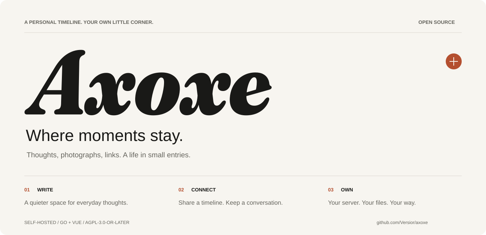
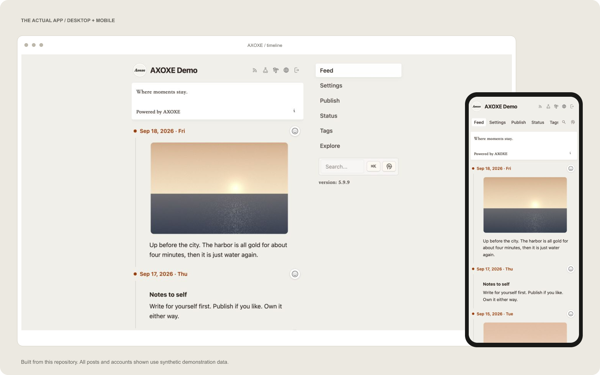
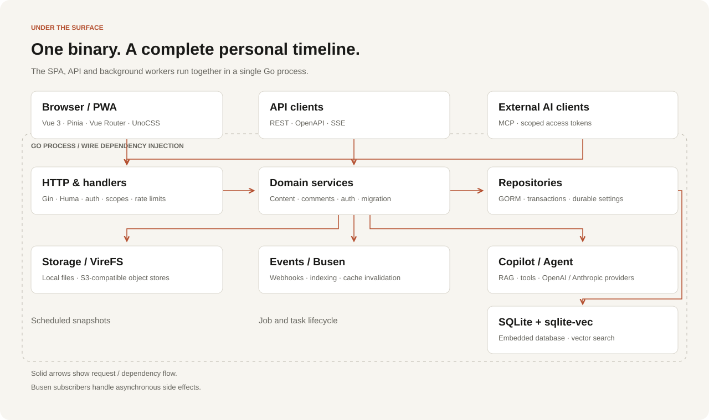

<div align="center">

<picture>
  <source media="(prefers-color-scheme: dark)" srcset="./docs/assets/readme/hero-dark.svg">
  
</picture>

<p>
  <a href="https://github.com/Versior/axoxe/actions/workflows/test.yml"></a>
  <a href="./LICENSE"></a>
  <a href="./go.mod"></a>
  <a href="./web/package.json"></a>
</p>

[English](./README.md) · [简体中文](./README.zh.md) · [Deutsch](./README.de.md) · [日本語](./README.ja.md)

**Ein eigener Ort für Gedanken, Momente und Erinnerungen.**

[Installation](#installation) · [Dokumentation](./docs/README.md) · [Mitwirken](https://github.com/Versior/axoxe/pulls)

</div>

Axoxe ist eine selbst gehostete persönliche Timeline für kurze Beiträge, Fotos, Links und Gespräche. Das Projekt ist ein eigenständig gestalteter Fork von [Ech0](https://github.com/lin-snow/Ech0), synchronisiert mit **v5.9.9**. Urheberrechtsvermerke, Lizenzen und kompatible Datenformate bleiben erhalten.



<sub>Die Bilder zeigen die tatsächliche Anwendung mit synthetischen Beispieldaten.</sub>

## Funktionen

| Bereich | Möglichkeiten |
| --- | --- |
| Schreiben | Markdown, Entwürfe, Tags, Vorschau, öffentliche und private Beiträge |
| Medien | Bildergalerien, Audio, Video und erweiterte Karten |
| Austausch | Kommentare, Moderation, Reaktionen, RSS und verbundene Instanzen |
| KI & Integration | Copilot, Vektorsuche, REST/OpenAPI, Webhooks und MCP |
| Daten | Snapshots, geplante Exporte, Memos-Import und portable Capsules |
| Zugang | Passkeys, Anmeldung über Drittanbieter, Rollen und widerrufbare Zugriffstoken |
| Oberfläche | Responsive Layout, PWA, Themes und vier Sprachen |

## Installation

Git, OpenSSL und Docker mit Compose werden benötigt. Das Image wird aus diesem Repository gebaut.

```sh
git clone https://github.com/Versior/axoxe.git
cd axoxe

# Create the session secret once. Keep this file for future starts and upgrades.
umask 077
[ -f docker/.env ] || openssl rand -hex 32 | sed 's/^/JWT_SECRET=/' > docker/.env

docker compose --env-file docker/.env -f docker/docker-compose.yml up -d --build
```

Öffne **http://localhost:6277**. Das erste registrierte Konto wird Owner. Behalte `docker/data/` und `docker/.env` bei Upgrades. Für ARM64 stelle dem Compose-Befehl `AXOXE_TARGETARCH=arm64` voran.

Ausführliche Anleitungen: [Deployment](./DEPLOYMENT.md), [Konfiguration](./docs/usage/configuration.md), [Entwicklung](./docs/dev/development.md).

## Technik

<table>
<tr>
<td align="center" width="16%"><br><strong>Go 1.27</strong><br>Gin · Huma · Wire</td>
<td align="center" width="16%"><br><strong>Vue 3</strong><br>Pinia · Vue Router</td>
<td align="center" width="16%"><br><strong>TypeScript 6</strong><br>Typed frontend</td>
<td align="center" width="16%"><br><strong>Vite 8</strong><br>UnoCSS · Vitest</td>
<td align="center" width="16%"><br><strong>SQLite</strong><br>GORM · sqlite-vec</td>
<td align="center" width="16%"><br><strong>Docker</strong><br>Compose · CGO</td>
</tr>
</table>



Ein Go-Prozess liefert API und eingebettete Vue-SPA aus. Huma generiert OpenAPI aus Go-Typen, Wire baut den Abhängigkeitsgraphen, Busen verteilt Ereignisse und VireFS verwaltet lokale sowie S3-kompatible Dateien. SQLite und sqlite-vec benötigen CGO.

Mehr dazu in der [Architekturübersicht](./docs/dev/architecture-overview.md). Für lokale Builds: Go 1.27.4+, C-Compiler, Node.js 26+, pnpm 12.14.0 und just. Zuerst `pnpm -C web build`, danach `just build`.

## Herkunft & Lizenz

Axoxe baut auf Ech0 von L1nSn0w und seinen Mitwirkenden auf. Lizenz: **[AGPL-3.0-or-later](./LICENSE)**. Siehe [NOTICE](./NOTICE) und [Compliance](./docs/legal/agpl-compliance.md). Die vollständigen Funktions- und Entwicklungsinformationen stehen in der [englischen README](./README.md).
