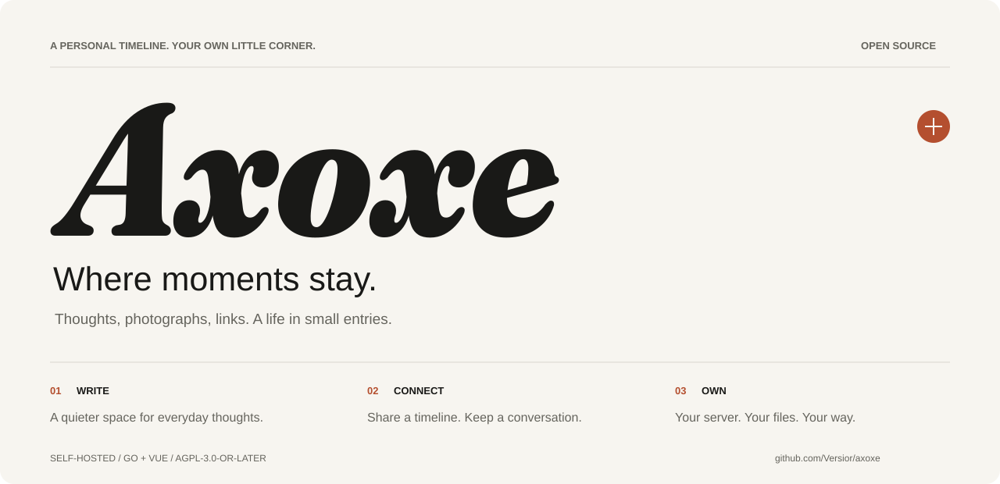
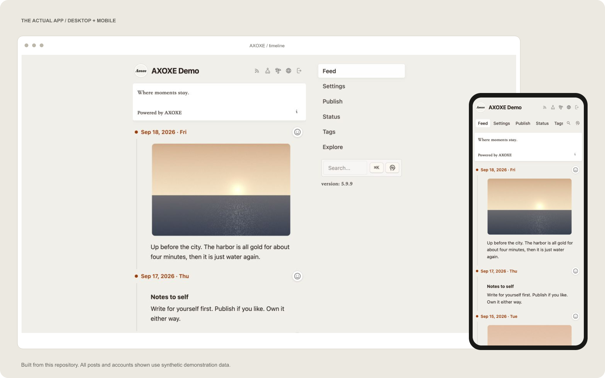
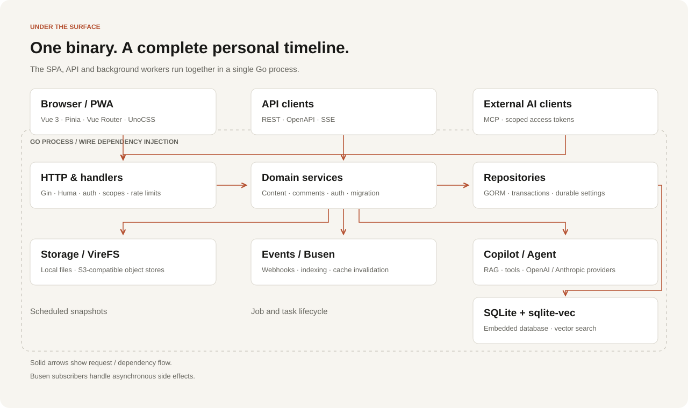

<div align="center">

<picture>
  <source media="(prefers-color-scheme: dark)" srcset="./docs/assets/readme/hero-dark.svg">
  
</picture>

<p>
  <a href="https://github.com/Versior/axoxe/actions/workflows/test.yml"></a>
  <a href="./LICENSE"></a>
  <a href="./go.mod"></a>
  <a href="./web/package.json"></a>
</p>

[English](./README.md) · [简体中文](./README.zh.md) · [Deutsch](./README.de.md) · [日本語](./README.ja.md)

**思いつきも、日々の瞬間も、自分の場所に。**

[はじめる](#はじめる) · [ドキュメント](./docs/README.md) · [貢献する](https://github.com/Versior/axoxe/pulls)

</div>

Axoxe は短い文章、写真、リンク、会話を残すためのセルフホスト型タイムラインです。[Ech0](https://github.com/lin-snow/Ech0) を基にした独立ブランドのフォークで、現在 **v5.9.9** と同期しています。上流の著作権表示、ライセンス、互換データ形式を維持しています。



<sub>本リポジトリからビルドした実際の画面です。記事とアカウントは合成デモデータです。</sub>

## 主な機能

| 分野 | 機能 |
| --- | --- |
| 書く | Markdown、下書き、タグ、プレビュー、公開・非公開の投稿 |
| メディア | 画像ギャラリー、音声、動画、拡張カード |
| 交流 | コメント、モデレーション、リアクション、RSS、インスタンス間の接続 |
| AI と連携 | Copilot、ベクトル検索、REST/OpenAPI、Webhook、MCP |
| データ | スナップショット、定期エクスポート、Memos インポート、持ち運べる Capsule |
| 認証 | パスキー、外部サービスでのログイン、役割、失効可能なアクセストークン |
| 表示 | レスポンシブ UI、PWA、テーマ、4 言語 |

## はじめる

Git、OpenSSL、Docker Compose を用意します。本リポジトリのソースからイメージをビルドします。

```sh
git clone https://github.com/Versior/axoxe.git
cd axoxe

# Create the session secret once. Keep this file for future starts and upgrades.
umask 077
[ -f docker/.env ] || openssl rand -hex 32 | sed 's/^/JWT_SECRET=/' > docker/.env

docker compose --env-file docker/.env -f docker/docker-compose.yml up -d --build
```

**http://localhost:6277** を開きます。最初に登録したアカウントが Owner になります。アップグレード時は `docker/data/` と `docker/.env` を保持してください。ARM64 では Compose コマンドの前に `AXOXE_TARGETARCH=arm64` を追加します。

詳しくは[デプロイ](./DEPLOYMENT.md)、[設定](./docs/usage/configuration.md)、[開発ガイド](./docs/dev/development.md)を参照してください。

## 技術構成

<table>
<tr>
<td align="center" width="16%"><br><strong>Go 1.27</strong><br>Gin · Huma · Wire</td>
<td align="center" width="16%"><br><strong>Vue 3</strong><br>Pinia · Vue Router</td>
<td align="center" width="16%"><br><strong>TypeScript 6</strong><br>Typed frontend</td>
<td align="center" width="16%"><br><strong>Vite 8</strong><br>UnoCSS · Vitest</td>
<td align="center" width="16%"><br><strong>SQLite</strong><br>GORM · sqlite-vec</td>
<td align="center" width="16%"><br><strong>Docker</strong><br>Compose · CGO</td>
</tr>
</table>



単一の Go プロセスが API と埋め込み Vue SPA を提供します。Huma は Go 型から OpenAPI を生成し、Wire は依存関係を構築します。Busen はイベントを配信し、VireFS はローカルと S3 互換のファイルを扱います。SQLite と sqlite-vec は CGO を使用します。

詳細は[アーキテクチャ解説](./docs/dev/architecture-overview.md)へ。ローカルビルドには Go 1.27.4+、C コンパイラ、Node.js 26+、pnpm 12.14.0、just が必要です。先に `pnpm -C web build`、続いて `just build` を実行します。

## 謝辞とライセンス

Axoxe は L1nSn0w と貢献者による Ech0 を基にしています。ライセンスは **[AGPL-3.0-or-later](./LICENSE)** です。[NOTICE](./NOTICE) と[遵守ガイド](./docs/legal/agpl-compliance.md)を確認してください。機能と開発手順の詳細は[英語 README](./README.md)にあります。
