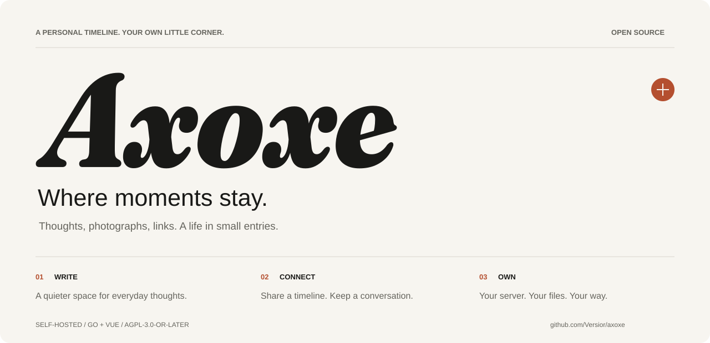
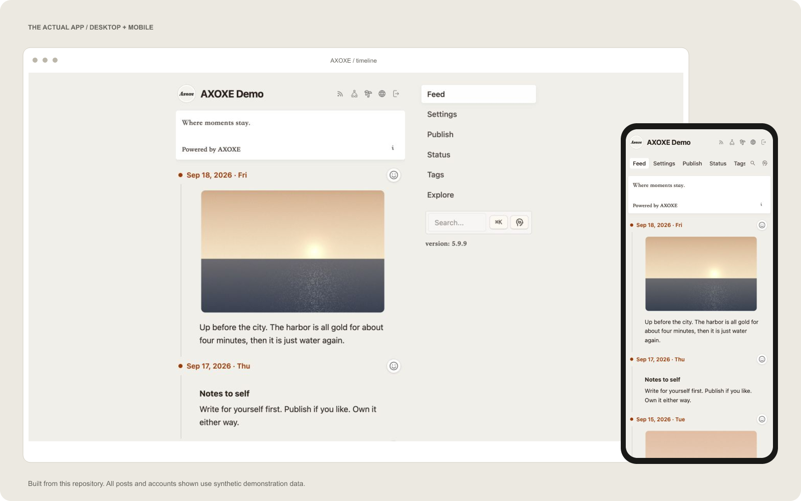
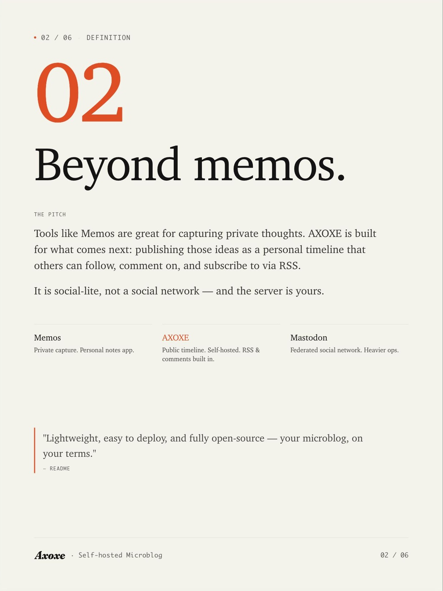
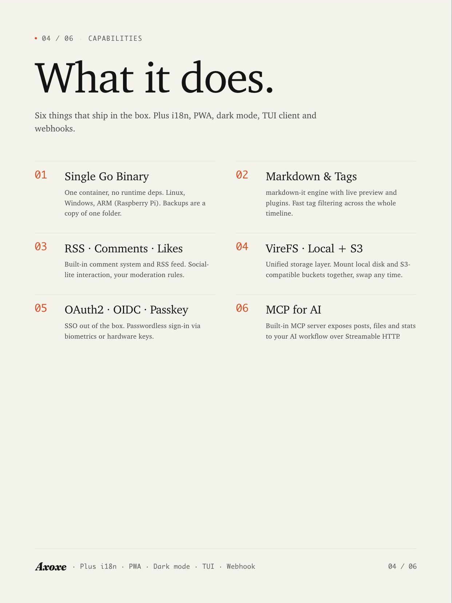
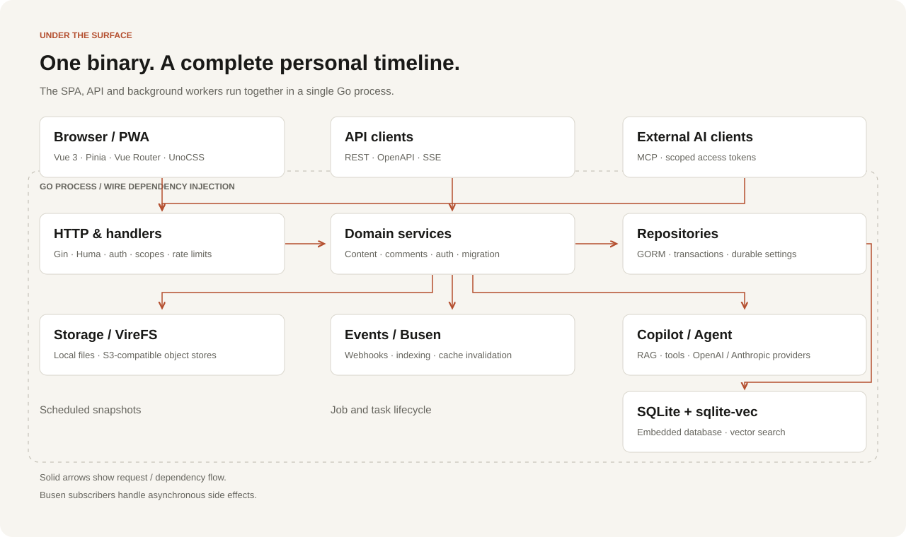
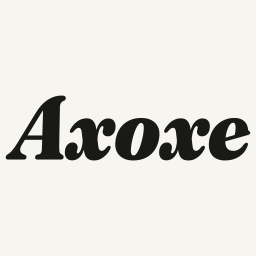

<div align="center">

<picture>
  <source media="(prefers-color-scheme: dark)" srcset="./docs/assets/readme/hero-dark.svg">
  
</picture>

<p>
  <a href="https://github.com/Versior/axoxe/actions/workflows/test.yml"></a>
  <a href="./LICENSE"></a>
  <a href="./go.mod"></a>
  <a href="./web/package.json"></a>
</p>

[English](./README.md) · [简体中文](./README.zh.md) · [Deutsch](./README.de.md) · [日本語](./README.ja.md)

**A self-hosted space for thoughts, moments, and reflection.**

[Get started](#get-started) · [Features](#made-for-your-everyday) · [Architecture](#small-footprint-real-engineering) · [Documentation](./docs/README.md) · [Contribute](https://github.com/Versior/axoxe/pulls)

</div>

Axoxe turns short notes, photographs, links, and small discoveries into a personal timeline. Publish it on your own server, invite a conversation, and keep your content in your hands.

An independent branded fork of [Ech0](https://github.com/lin-snow/Ech0), currently synchronized with **v5.9.9**. The interface uses the Axoxe wordmark throughout; upstream copyright, licenses, and compatible data formats are preserved.



<sub>Actual interface built from this repository. Posts and accounts in these images use synthetic demonstration data.</sub>

## Made for your everyday

| | Capability | What it gives you |
| :---: | --- | --- |
| ✍️ | **Write without ceremony** | Markdown, draft persistence, tags, live preview, and public or private posts. |
| 🖼️ | **More than plain text** | Image galleries, audio, video, and extension cards for links, music, GitHub projects, and locations. |
| 💬 | **A timeline with a conversation** | Comments, moderation, reactions, RSS, and connections to other instances. |
| 🧠 | **Find meaning in your own words** | Copilot summaries and streaming chat, with vector retrieval and configurable LLM providers. |
| 🔌 | **Connect your tools** | REST/OpenAPI, webhooks, and an authenticated MCP server with scoped tokens. |
| 🧳 | **Take your content with you** | Snapshot import/export, scheduled snapshots, Memos import, and portable content capsules. |
| 🔐 | **Choose how you sign in** | Passkeys, third-party sign-in, multi-account roles, and revocable access tokens. |
| 🌗 | **Feel at home on every screen** | Responsive UI, PWA installation, themes, and Chinese, English, German, and Japanese. |

<details>
<summary><strong>Explore the product in pictures</strong></summary>

| Product idea | Capabilities |
| --- | --- |
|  |  |

[Watch the product film](./docs/assets/video/ech0-promo.mp4) · [Browse the brand assets](./docs/brand/README.md)

</details>

## Get started

### Docker Compose

Build and run the branded application from source:

```sh
git clone https://github.com/Versior/axoxe.git
cd axoxe

# Create the session secret once. Keep this file for future starts and upgrades.
umask 077
[ -f docker/.env ] || openssl rand -hex 32 | sed 's/^/JWT_SECRET=/' > docker/.env

docker compose --env-file docker/.env -f docker/docker-compose.yml up -d --build
```

Open **http://localhost:6277** and create your first account. It becomes the **Owner** account with management privileges. Publishing is restricted to privileged accounts by default.

- Requires Git, OpenSSL, and Docker with Compose. The first run builds the image locally.
- Data persists in `docker/data/`; the session secret stays in `docker/.env`. Keep both when upgrading.
- On ARM64, prefix the Compose command with `AXOXE_TARGETARCH=arm64`.
- The image name `axoxe:local` refers to this local build. See [deployment and upgrade instructions](./DEPLOYMENT.md) for binary builds, configuration, and rollback considerations.

### Local development

Use **Go 1.27.4+**, a C compiler, **Node.js 26+**, **pnpm 12.14.0**, and [`just`](https://github.com/casey/just). SQLite and vector search use CGO.

```sh
pnpm -C web install --frozen-lockfile
pnpm -C web build
just build
./bin/axoxe serve
```

Build the frontend before the Go binary: `template/dist/` is embedded into the executable. Configure a persistent `JWT_SECRET` for a persistent instance. For hot reload, proxies, and project-specific runtimes, follow the [development guide](./docs/dev/development.md).

<details>
<summary><strong>Command-line client</strong></summary>

The standalone client lives in [`apps/cli`](./apps/cli), separate from the Go server. It supports terminal access to an existing instance.

```sh
cd apps/cli
bun install --frozen-lockfile
bun run src/index.ts --help
```

Use the Bun version specified by that project. Source builds are available; downloadable binaries and npm packages depend on an actual published release.

</details>

## Small footprint, real engineering

<table>
<tr>
<td align="center" width="16%"><br><strong>Go 1.27</strong><br>Gin · Huma · Wire</td>
<td align="center" width="16%"><br><strong>Vue 3</strong><br>Pinia · Vue Router</td>
<td align="center" width="16%"><br><strong>TypeScript 6</strong><br>Typed frontend</td>
<td align="center" width="16%"><br><strong>Vite 8</strong><br>UnoCSS · Vitest</td>
<td align="center" width="16%"><br><strong>SQLite</strong><br>GORM · sqlite-vec</td>
<td align="center" width="16%"><br><strong>Docker</strong><br>Compose · CGO</td>
</tr>
</table>



- **One Go process** serves the API and embedded Vue SPA, with job and task lifecycle management.
- **Clear domain layers** separate handlers, services, repositories, and storage. Wire composes dependencies at build time; Huma derives OpenAPI from Go types.
- **Busen** routes typed events to asynchronous subscribers for webhooks, indexing, and cache invalidation. **VireFS** unifies local files and S3-compatible storage.
- **MCP and Agent face opposite directions**: external AI clients call authenticated domain tools through MCP; Copilot calls configurable LLM providers through the Agent loop.
- **SQLite + sqlite-vec** keep the database and vector index in the same deployment. External object stores and LLM providers are optional integrations.

Read the [architecture walkthrough](./docs/dev/architecture-overview.md), [Agent design](./docs/dev/agent-toolcall-design.md), or [interactive architecture atlas](./site/public/arch/index.html).

## Find your way

| Run & maintain | Integrate & develop |
| --- | --- |
| [Deployment & upgrades](./DEPLOYMENT.md) | [Development setup](./docs/dev/development.md) |
| [Configuration reference](./docs/usage/configuration.md) | [Architecture overview](./docs/dev/architecture-overview.md) |
| [Storage migration](./docs/usage/storage-migration.md) | [MCP usage](./docs/usage/mcp-usage.md) |
| [Snapshots](./docs/dev/snapshot-design.md) | [Webhooks](./docs/usage/webhook-usage.md) |
| [Content capsules](./docs/usage/capsule.md) | [Access-token scopes](./docs/dev/access-token-scope-design.md) |

Your instance exposes interactive API documentation at **`/api/docs`**, with OpenAPI at `/api/openapi.json` and `/api/openapi.yaml`.

<details>
<summary><strong>Compatibility with existing Ech0 deployments</strong></summary>

Existing database and media paths, `ECH0_*` configuration keys, Go module imports, webhook contracts, and capsule identifiers retain their compatibility names. Export a snapshot before upgrading; keep your data directory and existing session secret. Saved instance titles and content are retained. Legacy logo URLs resolve to the Axoxe mark.

</details>

## Contribute

Start with the [contribution guide](./CONTRIBUTING.md). Build the frontend, then run the required checks before submitting a change:

```sh
just check          # SPDX, Go lint, OpenAPI, frontend formatting/lint/i18n
just test           # Go tests; build web first for the embedded assets
just web test       # Frontend tests
just build          # bin/axoxe, with commit and build time
```

The independent [`site/`](./site) documentation site and [`hub/`](./hub) directory have their own dependency and build commands. Contribute fork changes through [pull requests](https://github.com/Versior/axoxe/pulls), or report upstream defects in [Ech0 Issues](https://github.com/lin-snow/Ech0/issues). Security reports follow the [security policy](./SECURITY.md).

## Origins & license

Axoxe builds on **Ech0 by L1nSn0w and its contributors**. Thanks to the upstream community and the open-source projects behind the stack. Technology icons are from [Simple Icons](./docs/assets/readme/icons/README.md); the wordmark uses [Fraunces](./docs/brand/FRAUNCES-OFL.txt).

Licensed under **[AGPL-3.0-or-later](./LICENSE)**. When you distribute modifications or provide them as a network service, provide the corresponding source and preserve the required notices. Read [NOTICE](./NOTICE), the [compliance guide](./docs/legal/agpl-compliance.md), and the upstream [commercial licensing terms](./COMMERCIAL.md) for details.

<div align="center">



**Where moments stay.**

[Source](https://github.com/Versior/axoxe) · [Documentation](./docs/README.md) · [Ech0 upstream](https://github.com/lin-snow/Ech0)

</div>
