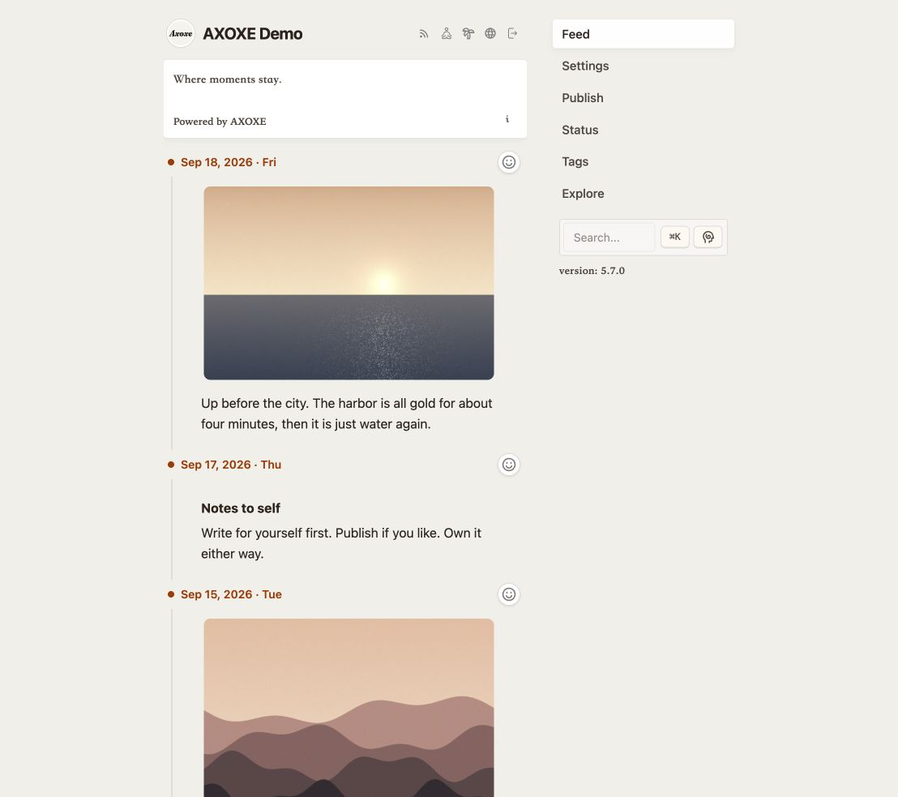

<div align="center">


# AXOXE

**Where moments stay.**

用于记录想法、日常片刻与自我回顾的自托管空间。

[Website](https://www.axoxe.com/) · [Documentation](./docs/README.md) · [Source](https://github.com/Versior/Ech0) · [Brand assets](./docs/brand/README.md)

[English](./README.md) · [简体中文](./README.zh.md) · [Deutsch](./README.de.md) · [日本語](./README.ja.md)

[AGPL-3.0-or-later](./LICENSE)

</div>

AXOXE 是基于 [Ech0](https://github.com/lin-snow/Ech0) v5.9.8 二次开发的独立品牌版本，保留原作者版权、许可证和上游归属。


> 自托管个人微博客：你的时间线可以被分享、讨论，同时数据完全由你掌控。

像 Memos 这样的工具非常适合快速记录想法。AXOXE 更关注“记录之后”的阶段：把内容发布到个人时间线，让更多人可以持续关注和互动。
你可以在自己的服务器上托管内容，保留完整控制权，同时通过可选评论与分享保持轻连接，而不是变成复杂社交平台。
它保持轻量、易部署、完全开源。

**适合你，如果你想：**
- 搭建一个自己的公开或半公开动态站
- 用统一界面发布短文、链接与媒体卡片
- 兼顾数据主权，同时保留 RSS 与评论等能力
- 让个人内容具备轻社交连接能力，而不需要重型社交产品

**不太适合你，如果你需要：**
- 双链知识库式的笔记工作流（例如 Obsidian 风格）
- 团队优先的协作文档平台（例如 Notion 风格）
- 纯备忘/笔记工具，完全不需要时间线与发布



---

<details>
   <summary><strong>目录</strong></summary>

- [1 分钟试用](#1-分钟上手)
- [完整能力清单](#完整能力清单)
- [部署与更新](#部署与更新)
- [常见问题](#常见问题)
- [反馈与社区](#反馈与社区)
- [开源治理与开发](#开源治理与开发)
- [Star 增长曲线](#star-增长曲线)

</details>

---

## 1 分钟上手

```shell
docker build -f docker/build.Dockerfile --build-arg TARGETOS=linux --build-arg TARGETARCH=amd64 -t axoxe:local .
docker run -d --name axoxe -p 6277:6277 -v /opt/axoxe/data:/app/data -e JWT_SECRET axoxe:local
```

Set a persistent `JWT_SECRET` in your shell before starting. The `axoxe:local` image is built from this source checkout; the upstream Docker image does not include AXOXE branding.

然后访问 `http://ip:6277`：

1. 注册你的第一个账号。
2. 首个账号会自动成为 Owner（管理员权限）。
3. 默认仅高权限账号可发布内容。

更多部署方式见 [极速部署](./DEPLOYMENT.md#quick-deployment)。

### CLI

安装 `axoxe` 命令行客户端（macOS / Linux，独立于服务端二进制）：

```shell
cd apps/cli
bun install --frozen-lockfile
bun run src/index.ts --help
```

源码构建需要 Bun 1.4.4 或更新版本。后续 AXOXE CLI 发布资产将在 [Releases](https://github.com/Versior/Ech0/releases) 使用 `axoxe-cli-<os>-<arch>.tar.gz` 命名，目前不能假定已上传。用法与命令见 [`apps/cli`](./apps/cli)。

## 完整能力清单

<details>
<summary><strong>点击展开完整能力清单</strong></summary>

### 产品亮点

- ☁️ **轻量高效架构**：低资源占用与小体积镜像，适合个人服务器到 ARM 设备。
- 🚀 **极速部署体验**：开箱即用 Docker 部署，从安装到运行一条命令即可启动。
- 📦 **自包含部署包**：提供完整二进制与容器镜像，无需额外依赖。
- 💻 **跨平台支持**：支持 Linux、Windows 与 ARM 架构设备（如 Raspberry Pi）。
- 🧳 **可携带内容胶囊**：把写过的内容导出为自包含[胶囊](./docs/usage/capsule.md)，可导入另一个实例，也可一条命令编译成静态站部署到任意托管平台。

### Storage & Data

- 🗂️ **VireFS 统一存储抽象层**：以 **VireFS** 统一本地存储与 S3 兼容对象存储的挂载与管理。
- ☁️ **S3 对象存储支持**：原生支持 S3 兼容对象存储，便于云端资源扩展。
- 📦 **数据主权架构**：内容与元数据由用户掌控，并支持 RSS 输出。
- 🔄 **数据迁移机制**：支持迁移导入历史数据，配合快照与胶囊导出实现迁移与归档，面板与 CLI 皆可操作。
- 🔐 **自动备份系统**：支持 Web、CLI、TUI 三种导出/备份方式与后台自动备份。

### Writing & Content

- ✍️ **Markdown 写作体验**：基于 **markdown-it** 的编辑与渲染引擎，支持插件扩展和实时预览。
- 🏷️ **标签管理系统**：支持标签分类、快速过滤与精准检索。
- 🃏 **富媒体卡片内容**：支持网站链接、GitHub 项目等卡片展示。
- 🎥 **视频内容解析**：支持哔哩哔哩与 YouTube 视频解析展示。

### Media & Assets

- 🎬 **多格式媒体附件**：可为每条 Echo 直接附加图片、音频与视频，内置画廊与音视频播放器行内呈现。
- 📁 **可视化文件管理器**：内建文件上传、浏览与资源管理能力。

### Social & Interaction

- 💬 **原生评论系统**：内建评论与评论管理功能，无需第三方评论服务。
- 🃏 **内容互动能力**：支持点赞、分享等社交互动。

### Auth & Security

- 🔑 **OAuth2 / OIDC 身份认证**：支持 OAuth2 与 OIDC 协议，便于接入第三方登录。
- 🙈 **Passkey 无密码登录**：支持生物识别或硬件密钥登录。
- 🔑 **访问令牌管理**：支持生成与吊销带 Scope 的访问令牌，便于 API 调用与第三方集成。
- 👤 **多账户权限管理**：支持多用户与权限控制。

### System & Developer

- 🧱 **Busen 数据总线架构**：通过自研 Busen 实现模块解耦通信与可靠消息传递。
- 📊 **结构化日志系统**：系统日志统一为结构化格式，提升可读性与可分析性。
- 🖥️ **实时系统日志控制台**：内建 Web 控制台可实时查看日志流，便于调试与排障。
- 📟 **TUI 管理界面**：提供终端交互界面，适合服务器环境管理。
- 🧰 **CLI 工具链**：提供 CLI 工具，支持自动化管理与脚本集成。
- 🔗 **开放 API 与 Webhook**：提供完整 API 与 Webhook，便于外部系统集成和自动化工作流。
- 🤖 **MCP（模型上下文协议）**：内建 [MCP Server](./docs/usage/mcp-usage.md)，**近乎完整覆盖**核心功能，帖子、文件与统计等能力通过 **Streamable HTTP** 以 **Tools / Resources** 交给上层 AI 工作流，**Scoped JWT** 鉴权。
- 🧠 **AXOXE Copilot（AI 副驾）**：内建于时间线的 AI 助手——**近况总结**一键把你最近的内容凝练成精炼摘要，**Chat** 让你直接与自己的内容对话、随问随答。底层基于**向量 RAG** 检索与**流式（SSE）**输出，每个回答都扎根于*你自己的*数据。

### Experience

- 🌍 **跨设备适配**：响应式设计，适配桌面、平板与移动浏览器。
- 🌐 **i18n 多语言支持**：支持多语言界面切换，覆盖不同语言使用场景。
- 👾 **PWA 支持**：支持安装为 Web App，体验更接近原生应用。
- 🌗 **主题与 Dark Mode**：支持深色模式与主题扩展。

### License

- 🎉 **完全开源**：基于 **AGPL-3.0** 协议发布，无追踪、无订阅、无 SaaS 依赖。

</details>

---

## 部署与更新

完整的 **Docker Compose**、**脚本安装**、**Kubernetes (Helm)** 部署说明以及**版本更新**操作流程详见 **[DEPLOYMENT.md](./DEPLOYMENT.md)**。

如果只是想最快跑起来，上面的 [1 分钟上手](#1-分钟上手) 已经足够 — 一条 `docker run` 命令即可启动。

---

## 常见问题

<details>
<summary><strong>点击展开 FAQ</strong></summary>

1. **AXOXE 是什么？**
   AXOXE 是一款轻量级的开源自托管平台，专为快速发布与分享个人想法、文字和链接而设计。它提供简洁的界面与零干扰体验，并确保数据始终由你自己掌控。

2. **AXOXE 不是什么？**
   AXOXE 不是传统的笔记软件，设计之初并不是为了专业的笔记管理和记录（如 Obsidian、Notion 等），AXOXE 的核心功能类似朋友圈/说说。

3. **AXOXE 是免费的吗？**
   是的，AXOXE 完全免费且开源，遵循 AGPL-3.0 协议。它没有广告、追踪、订阅或服务依赖。

4. **如何进行备份和导入数据？**
   AXOXE 支持通过“快照导出 / 迁移导入”进行数据迁移与恢复。部署层面建议定期备份你映射的数据目录（如 `/opt/axoxe/data`）。默认情况下核心数据位于本地数据库；若启用了对象存储，媒体文件会按存储配置写入对应后端。

5. **AXOXE 支持 RSS 吗？**
   是的，AXOXE 支持 RSS 订阅，您可以通过 RSS 阅读器订阅您的内容更新。

6. **为什么发布失败，提示联系管理员？**
   当前版本下，发布权限默认受限于高权限账号。初始化时创建的首个账号为 Owner（同时具备管理权限），普通用户默认不能发布，需要由高权限用户按实际策略授权。若是首次部署，请先对照 [1 分钟上手](#1-分钟上手) 确认首个账号是否为 Owner。

7. **为什么没有明确的权限划分？**
   AXOXE 当前采用轻量权限模型（Owner / Admin / 普通用户），目标是降低管理复杂度并保持日常使用流畅。后续会根据社区反馈持续迭代。

8. **为什么别人无法显示自己的 Connect 头像？**
   要使别人显示自己的 Connect 头像需要在 `系统设置-服务地址` 中填入自己当前的实例地址，比如 `https://memo.sn0w.fyi/`（注意：这里填的链接需要带上 http 或 https）。

9. **设置中的 MetingAPI 项是什么？**
   这是音乐卡片解析所使用的 API 地址。你可以填写自建或可信的解析服务；未配置时会使用系统默认解析地址。建议在生产环境中优先使用你可控的服务端点。

10. **为什么添加后的 Connect 只显示了一部分？**
      因为后端会尝试获取所有 Connect 的实例信息，如果某个实例挂了或者无法访问则会被抛弃，只返回获取到的有效 Connect 实例的信息给前端。

11. **如何开启评论功能？**
      在面板的评论管理页面开启评论并按需配置审核与验证码参数即可。当前为内建评论系统，无需额外接入第三方评论平台。

12. **S3 存储如何配置？**
      在存储设置中填写 Provider、Endpoint、Bucket、Access Key、Secret Key 等信息。`endpoint` 建议填写不含 `http/https` 的地址；若前端需直接访问媒体资源，请确保对象具备可访问策略（如 public-read 或等效 CDN/网关配置）。

13. **如何启用 Passkey 无密码登录？**
      在 `SSO - Passkey` 页面先配置 `WebAuthn RP ID` 与 `WebAuthn Origins`，保存并显示“Passkey 就绪”后，再按浏览器提示绑定你常用的生物识别或安全密钥设备即可使用。

14. **关于第三方集成平台的官方声明**
      未经 AXOXE 官方授权的第三方集成平台或服务，不属于官方支持范围。因使用此类平台或服务导致的安全事件、数据丢失、账号异常或其他风险与损失，由使用方及第三方自行承担，官方不承担相关责任。

15. **如何通过第三方集成（AI / 自动化）发布评论？**
      AXOXE 提供专用集成评论接口 `POST /api/comments/integration`，无需通过验证码或表单 token。使用前需在「访问令牌」管理中创建一个包含 `comment:write` scope 和 `integration` audience 的 access token，并在请求头中附带 `Authorization: Bearer <token>`。请求体字段与响应说明请以你部署实例上的 OpenAPI 文档为准：在浏览器打开 `/swagger/index.html`（本地开发一般为 `http://localhost:6277/swagger/index.html`）。该接口具有独立的频控策略，评论来源会标记为 `integration`，可在后台评论管理中识别。

16. **想详细了解本地与对象存储的数据布局、`key` 映射规则，以及更换 S3 或本地 ⇄ 对象互迁时要注意什么？**
      请参阅仓库内文档：[存储迁移指南](./docs/usage/storage-migration.md)。文中说明扁平 `key` 与 `schema.Resolve`、`PathPrefix`、入库 `url` 快照的含义，前台 `/api/files` 静态访问与 `stream` 接口的差异，以及更换 S3 服务商与本地存储和对象存储之间迁移的操作要点与注意事项。

</details>

---

## 反馈与社区

- 若程序出现 bug，可在 [Issues](https://github.com/Versior/Ech0/issues) 中反馈。
- 针对新增或改进的需求，欢迎前往 [Discussions](https://github.com/Versior/Ech0/discussions) 一起交流。
- 官方 QQ 群号：`1065435773`

### 加入上游 Hub

[Upstream Hub](https://hub.ech0.app/) 会聚合已登记的公开实例时间线。如果希望**自己的公开实例**出现在 Hub 列表中，详细的登记步骤请参见 [`hub/README.md`](./hub/README.md)。

| 官方 QQ 交流群                                                  | 其它交流群 |
| --------------------------------------------------------------- | ---------- |
|  | 暂无       |


---

## 开源治理与开发

**治理**

- [贡献指南](./CONTRIBUTING.md)
- [行为准则](./CODE_OF_CONDUCT.md)
- [安全策略](./SECURITY.md)
- [许可证](./LICENSE)

**开发**

本地开发环境、依赖安装与前后端联调说明请见 **[docs/dev/development.md](./docs/dev/development.md)**。更高层的项目架构与代码规范请参考 [`AGENTS.md`](./AGENTS.md) 与 [`CONTRIBUTING.md`](./CONTRIBUTING.md)。交互式架构图见 **[Architecture](./site/public/arch/index.html)**。

---

## Acknowledgements

AXOXE builds on Ech0 by L1nSn0w and its contributors. The upstream project and its bundled libraries retain their original licenses and copyright notices. See [NOTICE](./NOTICE), [LICENSE](./LICENSE), and the [brand guide](./docs/brand/README.md).
