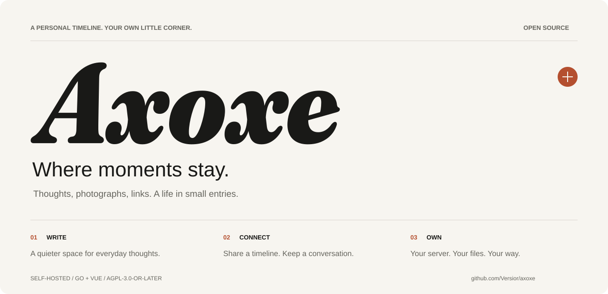
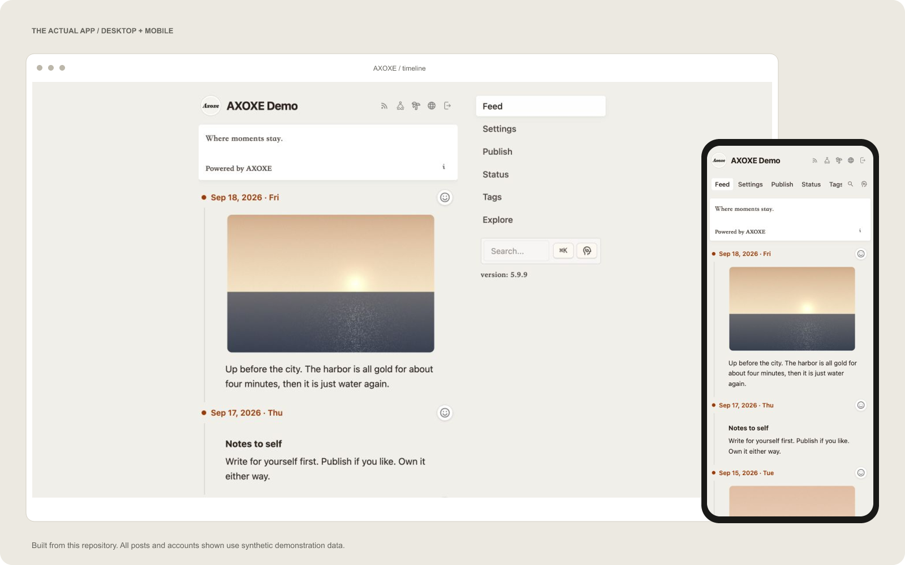
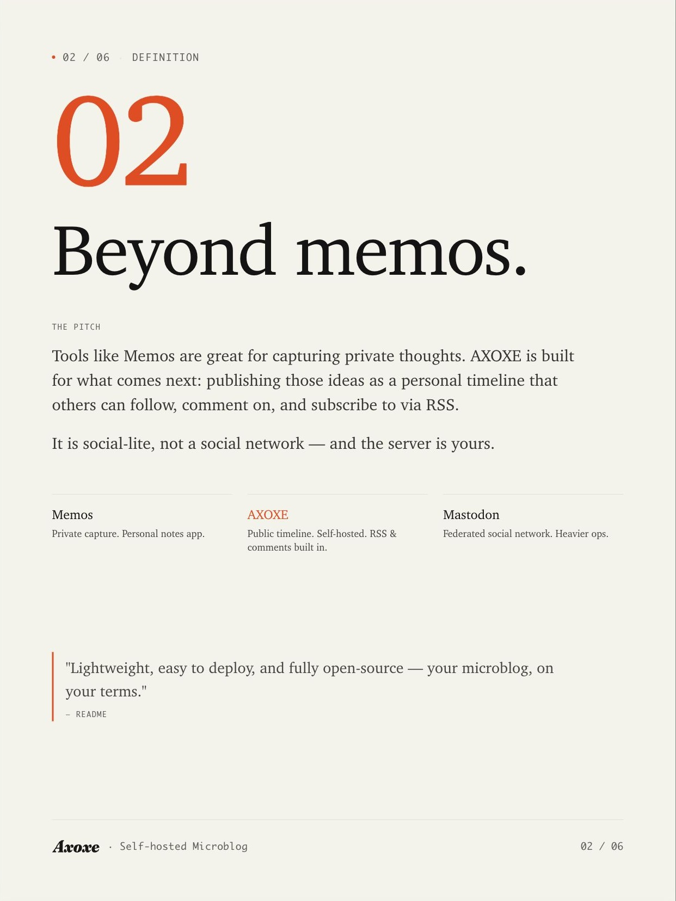
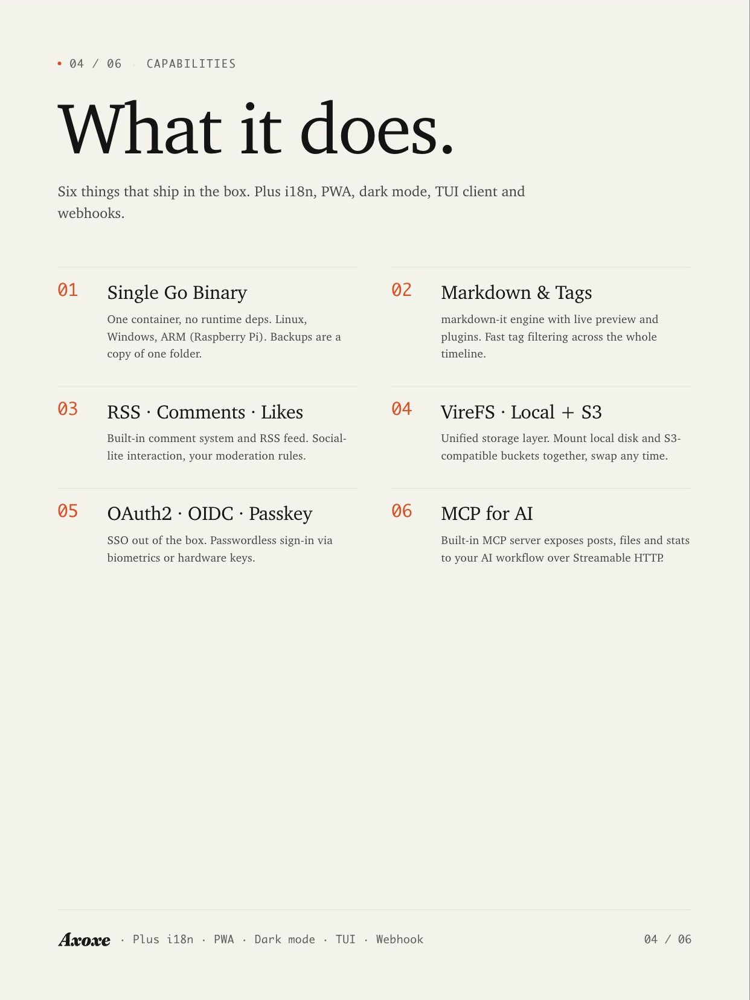
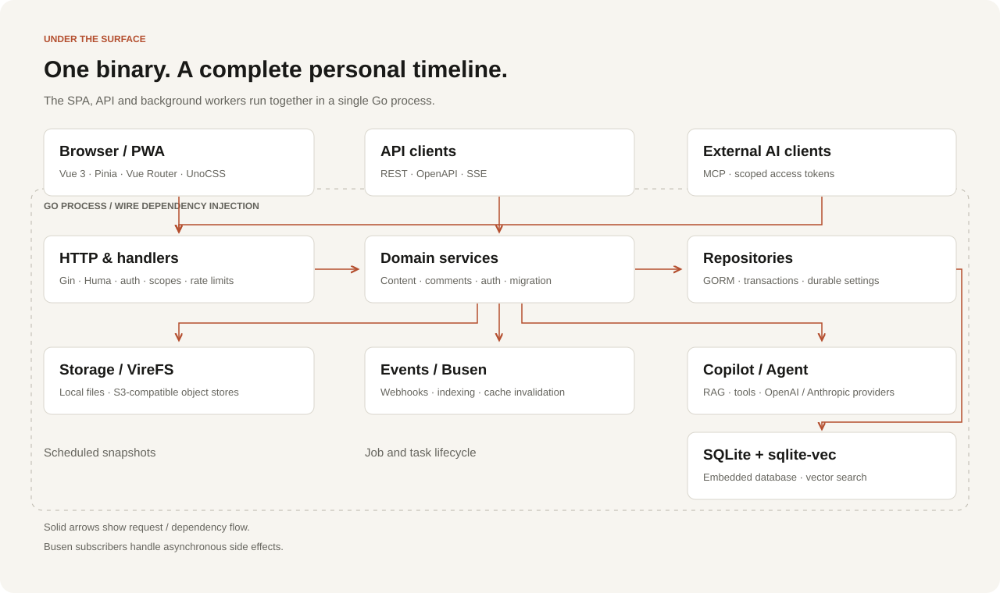
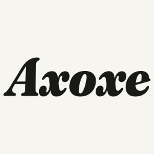

<div align="center">

<picture>
  <source media="(prefers-color-scheme: dark)" srcset="./docs/assets/readme/hero-dark.svg">
  
</picture>

<p>
  <a href="https://github.com/Versior/axoxe/actions/workflows/test.yml"></a>
  <a href="./LICENSE"></a>
  <a href="./go.mod"></a>
  <a href="./web/package.json"></a>
</p>

[English](./README.md) · [简体中文](./README.zh.md) · [Deutsch](./README.de.md) · [日本語](./README.ja.md)

**把想法、片刻与回望，留在自己的时间线上。**

[开始使用](#开始使用) · [功能一览](#日常记录也可以很完整) · [技术架构](#轻量部署扎实内核) · [完整文档](./docs/README.md) · [参与开发](https://github.com/Versior/axoxe/pulls)

</div>

Axoxe 是一个自托管的个人时间线。写短文，放照片，收藏链接，分享那些值得留下的小事。部署在自己的服务器上，让记录有归属，也让交流有空间。

本项目是 [Ech0](https://github.com/lin-snow/Ech0) 的独立品牌二开，目前同步至 **v5.9.9**。产品界面统一使用 Axoxe 字标，保留上游版权、许可证和数据兼容格式。



<sub>截图来自本仓库构建的实际应用。图片中的文章与账号均为合成演示数据。</sub>

## 日常记录，也可以很完整

| | 能力 | 可以做什么 |
| :---: | --- | --- |
| ✍️ | **随手写，也认真写** | Markdown、草稿保存、标签、实时预览，以及公开或私密内容。 |
| 🖼️ | **让记录有声有色** | 图片画廊、音视频，以及链接、音乐、GitHub 项目、地点等扩展卡片。 |
| 💬 | **一条能交流的时间线** | 评论、审核、互动、RSS，以及与其他实例建立连接。 |
| 🧠 | **和自己的记录聊聊** | Copilot 摘要与流式对话，支持向量检索和可配置的大模型服务。 |
| 🔌 | **把工具接进来** | REST/OpenAPI、Webhook，以及带访问范围控制的 MCP 服务。 |
| 🧳 | **内容跟着你走** | 快照导入导出、定时快照、Memos 导入和可携带的内容胶囊。 |
| 🔐 | **选择自己的登录方式** | 通行密钥、第三方登录、多账号角色和可撤销访问令牌。 |
| 🌗 | **每块屏幕都舒服** | 响应式界面、PWA、主题，以及中文、英文、德文和日文。 |

<details>
<summary><strong>展开更多产品展示</strong></summary>

| 产品理念 | 功能概览 |
| --- | --- |
|  |  |

[观看产品介绍视频](./docs/assets/video/ech0-promo.mp4) · [查看品牌资产](./docs/brand/README.md)

</details>

## 开始使用

### Docker Compose

从源码构建并启动 Axoxe：

```sh
git clone https://github.com/Versior/axoxe.git
cd axoxe

# 只生成一次会话密钥。后续启动和升级时保留这个文件。
umask 077
[ -f docker/.env ] || openssl rand -hex 32 | sed 's/^/JWT_SECRET=/' > docker/.env

docker compose --env-file docker/.env -f docker/docker-compose.yml up -d --build
```

打开 **http://localhost:6277**，注册首个账号。该账号自动成为 **Owner**，拥有管理权限。默认只有具有相应权限的账号能够发布内容。

- 需要 Git、OpenSSL 和带 Compose 的 Docker，首次启动会在本地构建镜像。
- 数据保存在 `docker/data/`，会话密钥保存在 `docker/.env`。升级时保留两者。
- ARM64 设备在 Compose 命令前添加 `AXOXE_TARGETARCH=arm64`。
- `axoxe:local` 是本地构建的镜像名。二进制构建、配置与升级步骤见[部署文档](./DEPLOYMENT.md)。

### 本地开发

准备 **Go 1.27.4+**、C 编译器、**Node.js 26+**、**pnpm 12.14.0** 和 [`just`](https://github.com/casey/just)。SQLite 与向量检索需要 CGO。

```sh
pnpm -C web install --frozen-lockfile
pnpm -C web build
just build
./bin/axoxe serve
```

先构建前端，再编译 Go：`template/dist/` 会被嵌入最终二进制。持久实例需要设置固定的 `JWT_SECRET`。热更新、开发代理和各子项目运行环境见[开发指南](./docs/dev/development.md)。

<details>
<summary><strong>独立命令行客户端</strong></summary>

[`apps/cli`](./apps/cli) 是连接已有实例的独立客户端，与 Go 服务端分开构建。

```sh
cd apps/cli
bun install --frozen-lockfile
bun run src/index.ts --help
```

Bun 版本以该子项目的约束为准。可以从源码运行；可下载二进制与 npm 安装方式取决于实际发布的版本。

</details>

## 轻量部署，扎实内核

<table>
<tr>
<td align="center" width="16%"><br><strong>Go 1.27</strong><br>Gin · Huma · Wire</td>
<td align="center" width="16%"><br><strong>Vue 3</strong><br>Pinia · Vue Router</td>
<td align="center" width="16%"><br><strong>TypeScript 6</strong><br>Typed frontend</td>
<td align="center" width="16%"><br><strong>Vite 8</strong><br>UnoCSS · Vitest</td>
<td align="center" width="16%"><br><strong>SQLite</strong><br>GORM · sqlite-vec</td>
<td align="center" width="16%"><br><strong>Docker</strong><br>Compose · CGO</td>
</tr>
</table>



- **一个 Go 进程**同时提供 API 和内嵌 Vue SPA，并管理后台任务的生命周期。
- **领域分层明确**：Handler、Service、Repository 各司其职。Wire 在编译时装配依赖，Huma 从 Go 类型生成 OpenAPI。
- **Busen 事件总线**按类型分发事件，由异步订阅者处理 Webhook、索引和缓存失效。**VireFS** 统一管理本地文件与 S3 兼容对象存储。
- **MCP 与 Agent 双向连接**：外部 AI 客户端通过鉴权后的 MCP 调用领域工具；Copilot 通过 Agent 循环调用可配置的大模型服务。
- **SQLite + sqlite-vec**让数据库与向量索引随应用部署。对象存储和大模型服务可按需接入。

深入了解[架构全景](./docs/dev/architecture-overview.md)、[Agent 工具调用设计](./docs/dev/agent-toolcall-design.md)与[交互式架构图](./site/public/arch/index.html)。

## 文档导航

| 部署与维护 | 集成与开发 |
| --- | --- |
| [部署与升级](./DEPLOYMENT.md) | [开发环境](./docs/dev/development.md) |
| [配置参考](./docs/usage/configuration.md) | [架构全景](./docs/dev/architecture-overview.md) |
| [存储迁移](./docs/usage/storage-migration.md) | [MCP 接入](./docs/usage/mcp-usage.md) |
| [快照设计](./docs/dev/snapshot-design.md) | [Webhook 接入](./docs/usage/webhook-usage.md) |
| [内容胶囊](./docs/usage/capsule.md) | [访问令牌与权限](./docs/dev/access-token-scope-design.md) |

实例的交互式 API 文档位于 **`/api/docs`**，OpenAPI 文件位于 `/api/openapi.json` 和 `/api/openapi.yaml`。

<details>
<summary><strong>现有 Ech0 实例的兼容说明</strong></summary>

数据库与媒体目录、`ECH0_*` 配置键、Go 模块路径、Webhook 协议和内容胶囊标识符保留兼容名称。升级前导出快照，保留原数据目录与会话密钥。已有实例标题和内容会被保留，旧 Logo 地址会显示 Axoxe 字标。

</details>

## 参与开发

先阅读[贡献指南](./CONTRIBUTING.md)。构建前端后，运行提交前要求的检查：

```sh
just check          # SPDX, Go lint, OpenAPI, frontend formatting/lint/i18n
just test           # Go tests; build web first for the embedded assets
just web test       # Frontend tests
just build          # bin/axoxe, with commit and build time
```

独立的 [`site/`](./site) 文档站与 [`hub/`](./hub) 实例目录有各自的依赖和构建命令。二开修改通过 [Pull requests](https://github.com/Versior/axoxe/pulls)交流，上游缺陷可提交到 [Ech0 Issues](https://github.com/lin-snow/Ech0/issues)。安全问题按[安全政策](./SECURITY.md)处理。

## 致谢与许可证

Axoxe 基于 **L1nSn0w 与贡献者开发的 Ech0**。感谢上游社区和技术栈背后的开源项目。技术图标来自 [Simple Icons](./docs/assets/readme/icons/README.md)，字标字体使用 [Fraunces](./docs/brand/FRAUNCES-OFL.txt)。

本项目采用 **[AGPL-3.0-or-later](./LICENSE)**。分发修改版本或通过网络提供修改版本的服务时，需要提供对应源码并保留必要声明。详细说明见 [NOTICE](./NOTICE)、[合规指南](./docs/legal/agpl-compliance.md)和上游[商业许可说明](./COMMERCIAL.md)。

<div align="center">



**Where moments stay.**

[源码](https://github.com/Versior/axoxe) · [文档](./docs/README.md) · [Ech0 上游](https://github.com/lin-snow/Ech0)

</div>
